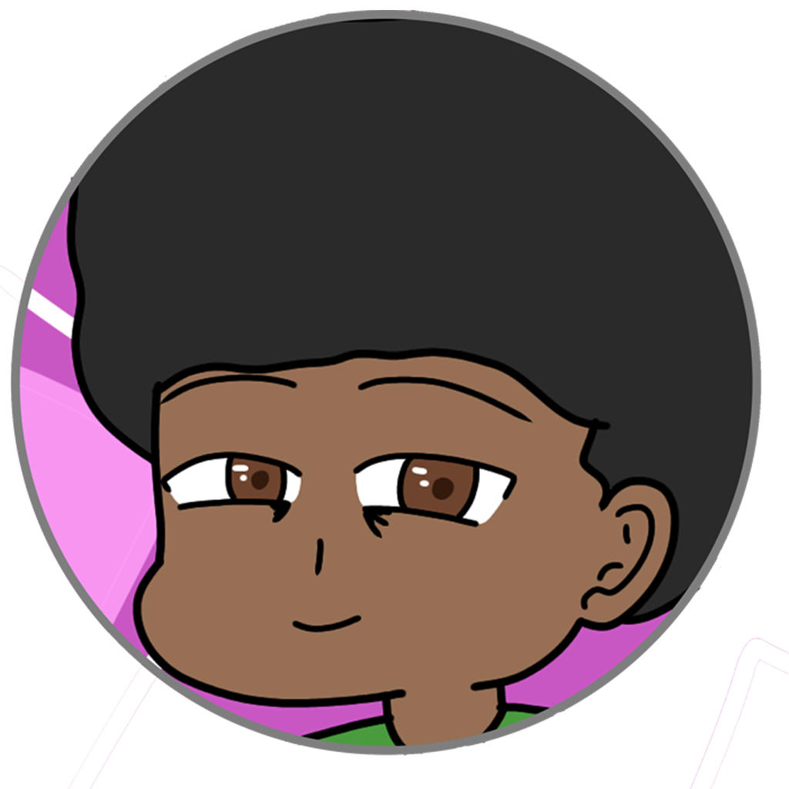

# danieruuz — Link na bio

## Estrutura
- `index.html`: página principal.
- `assets/icons/`: ícones SVG usados nos links.
- `assets/images/`: coloque aqui a logo e o avatar.

## Personalizar links
No `index.html`, substitua `SEU_USUARIO`, `SEU-PORTFOLIO.com`, `SEU-LINK.com`, `SEU-FUNKTOON-LINK.com` e `SEUEMAIL@exemplo.com` pelos endereços reais.

## Colocar a logo
Salve a logo como `assets/images/logo.png`. No cabeçalho, substitua o `<span class="brand-name">...` por:
```html

```

## Adicionar avatar
Salve a imagem como `assets/images/avatar.png` e retire os comentários que envolvem o bloco `.avatar-wrap` no HTML.

## Resolução recomendada do avatar
- **Ideal:** 1024 × 1024 px, proporção quadrada 1:1.
- **Mínimo:** 512 × 512 px.
- **Tamanho exibido na página:** 104 × 104 px; pode ser ajustado no CSS.
- Centralize o rosto e deixe 10–15% de margem em volta para o corte circular não cortar cabelo, orelhas ou acessórios.
- PNG funciona bem para ilustração/transparência; WebP costuma ser mais leve para imagem sem transparência.

Hospede a pasta inteira em GitHub Pages, Netlify ou Vercel, preservando os caminhos `assets/...`.
